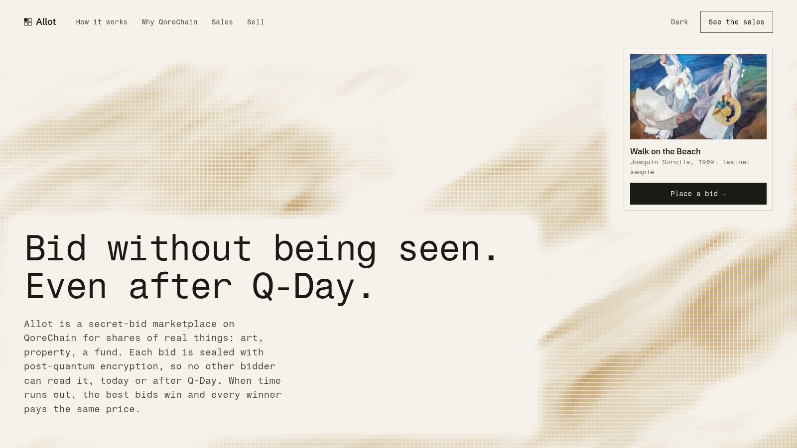

<div align="center">

<picture>
  <source media="(prefers-color-scheme: dark)" srcset="docs/mark-dark.svg">
  
</picture>

# Allot

**Bid without being seen. Even after Q-Day.**

A secret-bid marketplace on QoreChain testnet. Every bid is sealed with post-quantum encryption.

[](LICENSE)
[](https://allot.timidan.xyz)
[](web/src/lib/bid.js)
[](server/kit.mjs)
[](contracts/src/SealedSale.sol)
[](web/package.json)
[](server/package.json)

[Live site](https://allot.timidan.xyz) · [Video](https://youtu.be/U59-iEn75HU) · [Use it](#use-it) · [How a sale works](#how-a-sale-works) · [QoreChain integration](#qorechain-integration) · [Run it yourself](#run-it-yourself)

</div>



Allot sells shares of real things (a painting, a song, a fund) by sealed bid. A bid is sealed in the bidder's browser with ML-KEM-1024 to the seller's registered key, so no other bidder can read it before the sale ends, not even with a quantum computer. When time runs out, every bid is opened on chain, the best bids win, and every winner pays the same price. In new listings the key that opens a bid is split between three registered key holders, so no single key can. An agent or a script can list, bid and read its result from a shell with [one small tool](#from-an-agent-or-a-script), with no wallet.

Sale 1, ten shares of *Walk on the Beach*, ran on testnet with four sealed bids. Nobody else could read them until the close. Then the seller opened all four in [one transaction](https://allot.timidan.xyz/tx/0x584953b2ad1710f8d3438f837056a3bcf19d4c5688fc3060a85883ebf0a832ba), the contract checked each against its fingerprint, and the sale cleared at 24 fUSD:

| Bid | Won | Paid | Back from the 100 fUSD deposit |
|---|---|---|---|
| 3 shares at 30 fUSD | 3 | 72 fUSD | 28 fUSD |
| 4 shares at 25 fUSD | 4 | 96 fUSD | 4 fUSD |
| 4 shares at 24 fUSD | 3 | 72 fUSD | 28 fUSD |
| 5 shares at 20 fUSD | 0 | — | 100 fUSD |

Every bid, opening and claim is on [the sale's page](https://allot.timidan.xyz/sales/1). Sale 7 is a demo song, listed through [/sell](https://allot.timidan.xyz/sell) like any visitor's item. After its close the keeper settled it with no one stepping in: it [opened the guest's bid](https://allot.timidan.xyz/tx/0x79b75428c3d754cacd069df733736a50d26287466916763f72aeb2db3ac63e4c), [settled](https://allot.timidan.xyz/tx/0xd40c269ce494f2a05667b2148e752aeea5de5b416de7e761b3c6cc12813554c7), [delivered the 3 shares](https://allot.timidan.xyz/tx/0xfff2acaef33ad54ce9b188d5d29f57d1e316da64fae89ec44f57fd874de54faf) and [paid the proceeds](https://allot.timidan.xyz/tx/0x1ae5855ee435e7a9a044a5b01055aebf02e56bafd7891fcad2368e0fe8d7a280).

Built for QoreChain's *Build Before Q-Day* developer fest, category Encrypted Apps.

### The four Encrypted Apps requirements, on testnet

- **ML-KEM-1024 encryption, client side.** [A guest bid in sale 2](https://allot.timidan.xyz/tx/0xb8140a32734deb7c96730659a41c6c6fd25d56c7ba7665d480b98d5182e4e4a3): a 3,543-byte QoreSeal envelope sealed in the bidder's browser to two recipients, the seller and the bidder's receipt key ([`sealBid`](web/src/lib/bid.js)). New listings split the key instead, so no single key opens a bid: [a split bid in a test sale](https://allot.timidan.xyz/tx/0x1eb9af789cafa89b86d832dbed28cfaca63a6d4a9f74a5c1bbf1691b8ef579d8) is 7,246 bytes, the sealed bid and three key pieces, each sealed to a different holder's registered ML-KEM-1024 key.
- **Registered recipient keys.** The ML-KEM-1024 key registrations of [the sample seller](https://dashboard.qorechain.io/explorer/tx/7CFADD8568BB28FD7D1D5862C5983E2E18EE6017E13761D9B0D7529FA6E05C55) and of [Allot's listing account](https://dashboard.qorechain.io/explorer/tx/A761C38759DC012D7B3603DF0A285AF590CF4D0E4C5C20D883CB7486CC5948DE), both hybrid-signed with ML-DSA-87.
- **ML-DSA key binding.** Each sale's `SaleCreated` event carries the seller's recipient card, signed with ML-DSA-87. The browser checks it against both registered keys before it seals, and refuses a card that doesn't match.
- **Client-side decryption.** Bid in [sale 10](https://allot.timidan.xyz/sales/10), open until 15 Dec 2026, as a guest, then open *My bid*: your browser opens your envelope with the key in your receipt and checks it against the fingerprint the contract stored. The receipt file opens the bid in any other browser too. The practice auction on the home page opens all five of its bids in the browser. Sellers open bids outside the browser (see [Limits](#limits)).

## Use it

Open **https://allot.timidan.xyz** (QoreChain testnet; shares are test tokens and stand for nothing). No wallet is needed.

1. **Practise.** The home page replays sale 1 with your bid added. Price it and press *Seal it*: your browser makes an ML-KEM-1024 key and seals all five bids to it. Press *End the sale*: your browser opens every envelope with that key and settles the sale from what it opened.
2. **Bid.** Open a sale on [/sales](https://allot.timidan.xyz/sales), choose how many shares you want and the most you'll pay a share, then press *Leave a sealed bid*. Your browser seals the bid and Allot places it from a funded testnet guest account. Open *My bid*: your browser finds the bid on chain, opens its envelope with the key in your receipt, and checks it against the fingerprint the contract stored. After the close the same page shows the shares you won, the clearing price and your refund. The private receipt file opens in another browser. Keep it private because it contains your opening key. One guest bid per visitor a day.
3. **Sell.** On [/sell](https://allot.timidan.xyz/sell), upload an image or a song (JPEG, PNG, WebP, MP3, OGG, WAV or M4A, up to 8 MB), and set the shares, the lowest price and the length. Allot issues the shares and runs the sale. A song's waveform becomes its picture.
4. **Follow any transaction** on its own page, `/tx/<hash>`, read straight from testnet: what it did, its signature, and the post-quantum pass that let it through.

### From an agent or a script

The same guest route works without a browser. [`web/agent.mjs`](web/agent.mjs) seals with the site's own code and prints JSON, so a program can list, bid and read its result with no wallet:

```bash
cd web && npm install
node agent.mjs lots                           # lots open now: shares, lowest price, deposit, close time
node agent.mjs bid 10 2 4                     # sale 10: up to 2 shares at up to 4 fUSD each; writes a private receipt file
node agent.mjs result allot-bid-1a2b3c4d.json # opens your own bid from the chain; after the close, shares won, deposit returned, and the winners' file if the lot has one
node agent.mjs list cover.png --title "Cover" --by "An agent" --rights
```

The bid is sealed on the caller's machine and placed by one of Allot's guest accounts. The receipt file holds the only key, apart from the sale's key holders', that opens the bid; the *My bid* page reads the same file. The guest limits apply: one guest bid and one listing per visitor a day. Set `ALLOT` to use another server.

To bid from your own wallet, use QoreX on testnet: the browser extension, or the dApp browser in its mobile app. Bids come from an Ethereum (coin 60) account in QoreX, with QOR and fUSD from [QoreChain's faucet](https://dashboard.qorechain.io/faucet), and an EVM access window opened in QoreX.

## How a sale works

1. **The shares.** Each item is a CMTAT token built from QoreChain's Asset Kit, with the kit's holder rule: only accounts with a registered ML-DSA-87 key can hold it. The issuer grants the sale contract the right to mint it.
2. **The seller's card.** The seller registers an ML-KEM-1024 key on chain and signs a recipient card that binds it to their account with ML-DSA-87. The card is written into the sale when it is created.
3. **A bid.** The bidder's browser checks that the card belongs to the sale's seller and matches the keys registered on chain. It then seals `{price, shares, salt}`, padded to a fixed size, to two recipients: the seller, and a fresh key kept only in the bidder's receipt. The contract stores only a fingerprint of the bid and the sealed envelope. Every envelope is the same size and every bid locks the same deposit, so neither says anything about the bid. With the receipt, the bidder's browser can open their own bid from the chain at any time.
   **Split bids (new listings).** The sale publishes three cards: the seller's, a second key holder's and a recovery key's. The browser checks that they are three different registered accounts, seals the bid to the receipt key only, and cuts that key's seed into three pieces, one sealed to each holder ([`split.mjs`](server/split.mjs)). Any two holders rebuild the key; one holder's piece is random bytes. Each piece is tied to its sale, its bid and its holder, so a piece copied anywhere else won't open.
4. **Who may bid.** The contract admits a bidder only if QoreChain's PQC key-status precompile (`0x0A02`) shows a registered ML-DSA-87 key. A bid is an EVM transaction, accepted only inside an EVM window the bidder opened with an ML-DSA-87-signed native transaction. Guest windows are scoped to the sale contract and fUSD.
5. **The close.** The seller opens each envelope, and the contract checks each opened bid against its fingerprint. The best bids win and every winner pays the lowest winning price. Winners' shares are minted to them, and the rest of every deposit comes back. A bid nobody opens loses 10% of its deposit to the bids that were opened. Allot takes 1% of the proceeds.

6. **A file for the winners.** A lot can promise its winners a file: its SHA-256 goes into the token's information text when the token is issued, so the promise is on chain before the sale exists. After the payout a winner asks for its copy with the public half of the key in its receipt. The server reads the bid from the chain, checks that it won and that the key is the one the bid was sealed to, and seals the file to that key with ML-KEM-1024. The winner's browser, or [`agent.mjs`](web/agent.mjs), opens it with the receipt, checks it against the SHA-256 promised on chain, and only then saves it. The sealed copy opens with that receipt and nothing else, so it can sit in public.

When a visitor lists an item through /sell, Allot acts as the auction house: its own account issues the token, and a keeper opens, settles and pays out after the close. For a split sale the keeper holds one key of three. After the close it asks the second key holder ([`witness.mjs`](server/witness.mjs)) for its pieces; that holder reads the close time and the bids from the chain itself and gives nothing while the sale is open. If it is down, the recovery key takes its place.

## QoreChain integration

| Feature | Where | What it does here |
|---|---|---|
| QoreSeal, ML-KEM-1024 (hybrid with X25519), client-side encryption | [`web/src/lib/bid.js`](web/src/lib/bid.js) (`sealBid`) | Seals every bid in the browser to the seller's card and to the bidder's receipt key |
| Client-side decryption | [`web/src/TxPage.jsx`](web/src/TxPage.jsx), [`web/src/TryAuction.jsx`](web/src/TryAuction.jsx) | Opens your own bid from the chain in your browser with your receipt's key; the practice auction opens all five bids in the browser |
| Registered recipient keys, ML-DSA-87 key binding | [`server/consign.mjs`](server/consign.mjs) (`setupIssuer`) | Registers the seller's ML-KEM-1024 key and signs its recipient card |
| Hybrid ML-DSA-87 transactions, PQC key registration with proof of possession | [`server/kit.mjs`](server/kit.mjs), [`server/setup-guests.mjs`](server/setup-guests.mjs) | Registers each account's ML-DSA-87 key with proof of possession; every native transaction after that is signed with ML-DSA-87 as well as ECDSA |
| EVM windows, scoped | [`server/kit.mjs`](server/kit.mjs) (`ensureWindow`) | Guests' windows let through only the sale contract and fUSD |
| Solidity PQC key status (precompile `0x0A02`) | [`contracts/src/SealedSale.sol`](contracts/src/SealedSale.sol) (`isHybridHolder`) | Refuses bids from accounts without a registered ML-DSA-87 key |
| Asset Kit: CMTAT with the post-quantum holder rule | [`server/consign.mjs`](server/consign.mjs) (`createListing`) | Each listed item's shares, with the file's URL and SHA-256 in the token's terms |
| Test token fUSD | [`contracts/src/SealedSale.sol`](contracts/src/SealedSale.sol) | Deposits, payments and refunds |
| QoreX | [`web/src/lib/qorex.js`](web/src/lib/qorex.js), [`web/src/Wallet.jsx`](web/src/Wallet.jsx) | Wallet status in the header and bids from QoreX. QoreX doesn't sign fUSD's coin-to-token conversion, so a QoreX bidder short of fUSD is sent it by the server (`/api/fusd` in [`server/guest.mjs`](server/guest.mjs)) |

Kits: `@qorechain/sdk`, `@qorechain/qoreseal`, `@qorechain/evm` and `@qorechain/qorex-types`, in [`web/package.json`](web/package.json) and [`server/package.json`](server/package.json).

### Testnet addresses (`qorechain-diana`)

| What | Address |
|---|---|
| Sale contract | `0x284b10c4760794d25c71dc90183c3dc9b6d1f42a` |
| Seller of the sample sales | `qor1e3almehdqyhxay9n95qe0xu8ud9vqpryd0dlvx` |
| Allot, running listed sales | `qor1g495xe2zgk0gg2t4jg3u2m2mzuv3gdql7s7en4` |
| Guest bidder | `qor1rj37hg8l46lx0wukj0sx0j29t9drfhdc96qeuy` |
| Shares of *Walk on the Beach* | `0x8febcef691032a61956c7f1e1bc0b9094b16c16c` |

### Q-Day Drill (18 Nov 2026)

Allot's drill account is `qor12xwh4pplcscdy7s8mt4ye2xm2m93k2enhhfj3c` (`0x519d7A843fc430d27a07DAEa4Ca8dB56CB1b2B33`), a new testnet account with an ML-DSA-87 key registered with proof of possession. It holds QOR, fUSD, two *Walk on the Beach* shares and a sealed bid on sale 9.

- **Proof transaction:** [`DD3F2528…E016B9`](https://dashboard.qorechain.io/explorer/tx/DD3F2528B9D63153FA3C36169125C166F5F66BAAAD8AF15A0E0F45BDDFE016B9), block 10307038, 18 Nov 09:07:49 UTC. A hybrid-signed native transaction that registers the account's QoreSeal key.
- **What the leaked ECDSA key alone was refused before the drill:** native transfers and opening an EVM window (the hybrid signature is required), replacing the ML-DSA-87 key, EVM transfers, approvals and calls into the sale contract (no open window), an EIP-7702 delegation sent by another account, and a relayed MetaMask-style spend.
- **Threat model:** the account's windows stay closed except for the seconds a bid takes, scoped to the sale contract and fUSD, with the deposit approved exactly. fUSD and the shares have no permit and no trusted forwarder, so the key can sign nothing off chain that moves them. Bids are sealed with ML-KEM-1024, so the key reads none of them.

## Limits

- **Bids are private until the close, not for ever.** When the sale ends, every bid's price and shares are published on chain as it is opened.
- **In older sales the seller can read bids before the close.** In the sample sales and in sale 10, bids are sealed to the seller, or to Allot for listed items. Other bidders and outsiders cannot read them.
- **In split sales one operator still holds all three keys.** No single key opens a bid, and the second key holder refuses until the chain says the sale has closed. But that holder runs as a separate container on the same server as the sale server, so the split is between processes, not machines, and Allot's owner holds the recovery key too. The design is for three independent holders; this demo doesn't have them. Any two holders who chose to could combine their pieces before the close.
- **A split bid can't be checked when it arrives.** The server checks only what one key holder can: that the bid is well formed, that each piece is addressed to its holder, and that its own piece opens. A bid built to pass that and still not open stays unopened. It then loses 10% of its deposit, and the sale's settlement waits for the two-day opening window.
- **A winners' file is private from non-winners, not from Allot.** Allot's server holds the file as it is and seals a copy for each winner, so its operator can read it. Every winning bid gets the same file whatever its size, and nothing stops a winner from passing it on. Only Allot's operator can attach a file to a lot, and only in a split sale: a lister can promise only a file the operator already holds.
- **Sellers open bids outside the browser.** For single-key listings, Allot's server opens a guest bid when it is placed, to refuse one that could never be opened. Its keeper opens every bid after the close to publish it on chain. The sample sales were opened by the seller's own script. Only the bidder's side of the decryption runs in the browser.
- **A bid's own signature is ECDSA.** It is admitted only inside a window opened with ML-DSA-87, but the bid transaction itself is not ML-DSA-signed.
- **Bidding from QoreX** has not been tested with a real wallet, and QoreX's mobile app may not yet send EVM transactions.
- **Listed items' proceeds stay with Allot** on testnet; they are not forwarded to the person who listed the item.

## Run it yourself

The site:

```bash
cd web
npm install
npm run dev
```

It opens on http://localhost:5173 and reads the live sale contract on testnet. The dev server relays `/rest` to QoreChain's REST API and `/api` to the server below on port 8787. Without the server, sales still load; guest bids and listings need it.

The server (guest bids, listings and the keeper), with Node 22.9 or later:

```bash
cd server
npm install
cp .env.example .env
npm run setup
npm start
```

`npm run setup` funds the guest accounts and the listing account from a treasury mnemonic that holds testnet QOR and fUSD (see [`.env.example`](server/.env.example)), and creates the guest mnemonic if it is missing. Run it on your own machine; the server only needs the guest mnemonic.

For one optional backup pair, set `BACKUP_LOTS=11,12` using the IDs of two open Allot-managed lots with the same deposit. The backup must close at least an hour after the first lot’s reveal deadline. The guest enters a separate maximum for the backup. Allot queues its ciphertext and places it only after the first bid was opened, returned the full deposit and delivered no shares. The auction house holds the opening key and decrypts a guest bid to validate it before submitting it. Keep the server’s `DATA` volume across restarts. It holds the signed transaction and receipt status in `guest-bids.json`.

For split bids, run a second key holder from its own mnemonic, apart from the server: `WITNESS_MNEMONIC_FILE=… ISSUER=<the listing account, 0x…> node witness.mjs`. `node witness.mjs card` prints a holder's card; do the same once with a recovery mnemonic that stays offline. Put the two cards in a JSON array and start the server with `HOLDER_CARDS_FILE` set to that file and `HOLDERS_AT` to the key holder's address (`http://127.0.0.1:8788`). Each holder needs about 1 testnet QOR to register its keys. Without these two settings, listings stay single-key.

For a file sealed to each winner, first put the file in the server's data folder as `winners/<sha256>`, then list the lot with `--winners <file>` (the tool sends only the file's SHA-256). It needs a split sale. The server never serves the file as it is.

The contract:

```bash
git submodule update --init   # the Asset Kit, in contracts/lib
cd contracts
forge test
```

## Repository

| Path | What lives there |
|---|---|
| [`contracts/`](contracts) | `SealedSale.sol` (sealed-bid, uniform-price sale with the PQC holder check) and its Foundry tests |
| [`web/`](web) | The site: Vite, React 19, Tailwind 4, viem. Pages in [`web/src`](web/src): home, sales, one sale, sell, transaction |
| [`web/src/lib/`](web/src/lib) | Sealing (`bid.js`), chain reads (`chain.js`), QoreX (`qorex.js`) |
| [`web/agent.mjs`](web/agent.mjs) | The command-line client for agents and scripts: lots, bid, result, list |
| [`server/`](server) | Guest bids and listings ([`guest.mjs`](server/guest.mjs)), token issuing and the keeper ([`consign.mjs`](server/consign.mjs)), the split-bid format shared with the browser ([`split.mjs`](server/split.mjs)), the second key holder ([`witness.mjs`](server/witness.mjs)), chain helpers ([`kit.mjs`](server/kit.mjs)), guest funding ([`setup-guests.mjs`](server/setup-guests.mjs)) |
| [`server/kit/`](server/kit) | The Asset Kit's CMTAT build used for listed items |

## Credits

- **QoreChain kits:** [`@qorechain/sdk`](https://www.npmjs.com/package/@qorechain/sdk), [`@qorechain/qoreseal`](https://www.npmjs.com/package/@qorechain/qoreseal), [`@qorechain/evm`](https://www.npmjs.com/package/@qorechain/evm), [`@qorechain/qorex-types`](https://www.npmjs.com/package/@qorechain/qorex-types), and the [QoreChain Asset Kit](https://github.com/qorechain/qorechain-asset-kit) v0.1.0 (its `IQorePqcKeyStatus` interface, and its CMTAT build in [`server/kit/`](server/kit), see its [`NOTICE`](server/kit/NOTICE)).
- **CMTAT**, the token standard behind the shares, by [CMTA](https://github.com/CMTA/CMTAT).
- **Site:** [React](https://react.dev), [Vite](https://vite.dev), [Tailwind CSS](https://tailwindcss.com), [Motion](https://motion.dev), [viem](https://viem.sh), `clsx` and `tailwind-merge`.
- **Server:** [CosmJS](https://github.com/cosmos/cosmjs) (`@cosmjs/stargate`, `cosmjs-types`) and viem.
- **Contract:** [Foundry](https://getfoundry.sh).
- **Fonts:** Schibsted Grotesk, Fragment Mono and Bodoni Moda, from Google Fonts (SIL Open Font License).
- **Image:** the photograph of *Walk on the Beach* is by Ángel M. Felicísimo, CC BY 2.0, via Wikimedia Commons.

No project template was used.

## Licence

Apache-2.0.
